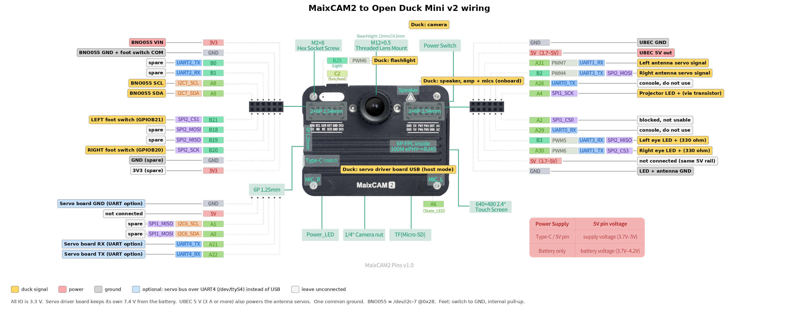

# Open Duck Mini on MaixCAM2

A runtime for [Open Duck Mini v2](https://github.com/apirrone/Open_Duck_Mini) that replaces the Raspberry Pi Zero 2W with a [Sipeed MaixCAM2](https://wiki.sipeed.com/hardware/en/maixcam/maixcam2.html) (AX630C, 2x A53, 3.2 TOPS INT8 NPU, built-in camera). The hardware is the standard v2 BOM; only the brain changes.

The roadmap is in [docs/PLAN.md](docs/PLAN.md). This first part (step 1) ports the [Pi runtime](https://github.com/apirrone/Open_Duck_Mini_Runtime) so the pretrained walking policy runs on the MaixCAM2, first on the CPU and then on the NPU.

## What changed from the Pi runtime

| Pi runtime | Here | Why |
|---|---|---|
| `rustypot` (Rust extension) | `odm_maix/feetech.py`, pure Python + pyserial | Nothing to compile for the board; reads position and velocity in one bus transaction |
| `adafruit_bno055` through Blinka | `odm_maix/bno055.py` over `/dev/i2c-N` (smbus2) | Blinka has no MaixCAM2 board definition |
| `board`/`digitalio` foot switches | `maix.gpio` | MaixCAM2 GPIO |
| `onnxruntime` only | `onnx` (CPU) or `npu` (`maix.nn` + Pulsar2 `.axmodel`) backends | NPU inference |
| calibration in `.pkl` | `~/imu_offsets.json` | Plain file |

These stay exactly the same, because the policy depends on them: the 101-value observation layout, the action scale (0.25), servo IDs, init pose, gains, the gait phase clock, and the rustypot unit conversions. `tests/` checks them.

## Wiring

The full pin table, connector map and power layout are in [docs/WIRING.md](docs/WIRING.md). In short (all MaixCAM2 IO is **3.3 V**):



<sub>Base pinout drawing: [Sipeed MaixCAM2 pins](https://wiki.sipeed.com/hardware/en/maixcam/maixcam2.html). Duck labels added for this project.</sub>


| Part | MaixCAM2 |
|---|---|
| UBEC 5 V | 5V + GND on the right header |
| Servo driver board | Type-C in USB host mode (`/dev/ttyACM0`), or UART4 `A21`/`A22` (`/dev/ttyS4`) |
| BNO055 | 3V3, GND, `A8` I2C7_SCL, `A9` I2C7_SDA |
| Foot switches (to GND) | left `B21`, right `B20` |
| Antenna servos | `A31` PWM7, `B2` PWM4 |
| Eye LEDs, projector | `B3` PWM5, `A30` PWM6, `A4` GPIO |
| Speaker, mic, camera | onboard, no wiring |

## Setup on the MaixCAM2

```bash
git clone https://github.com/aizatrosli/odm-maixcam2 && cd odm-maixcam2
pip3 install -r requirements.txt
cp example_duck_config.json ~/duck_config.json   # then set your joint offsets and pins
# from the Pi runtime / Open_Duck_Mini repos:
#   ~/BEST_WALK_ONNX_2.onnx
#   ~/polynomial_coefficients.pkl   (or set maixcam2.nb_steps_in_period)
```

If you already have a `duck_config.json` from the Pi, reuse it and add the `maixcam2` section.

## Bring-up, in order

Start with the diagnostics and calibration tools in [docs/BRINGUP.md](docs/BRINGUP.md). They check every servo, the IMU, the feet, the camera, NPU and audio and the 50 Hz loop without turning servo torque on, then calibrate joint offsets, joint ranges and the IMU. Both run on a PC against a simulated duck with `--dry-run`:

```bash
python3 scripts/diagnose.py                # config, board, servos, IMU, feet, camera, NPU, loop timing
python3 scripts/diagnose.py -i             # plus guided steps: tilt the duck, press each foot, listen
python3 scripts/calibrate.py offsets       # then ranges, imu, servo-id
python3 scripts/diagnose.py --dry-run -i --fault missing:23,upside_down   # no robot needed
```

The single-purpose scripts are still there:

```bash
python3 scripts/find_pins.py               # check the pins in docs/WIRING.md
python3 scripts/check_motors.py            # all 14 servos answer, torque off
python3 scripts/test_imu.py                # upright -> accelero ~ [0, 0, +9.8]
python3 scripts/test_imu.py --calibrate    # saves ~/imu_offsets.json
python3 scripts/test_feet.py
python3 scripts/walk.py --no_gamepad       # walk in place, policy on CPU
python3 scripts/walk.py --save_obs obs.npy # walk around a bit with the gamepad, record observations
```

`walk.py` prints the loop time, policy time and overruns every 5 seconds. The loop has 20 ms per step at 50 Hz.

## Running the policy on the NPU

On a PC with Docker and the Pulsar2 image ([Sipeed guide](https://wiki.sipeed.com/maixpy/doc/en/ai_model_converter/maixcam2.html)):

```bash
pip install -r requirements-dev.txt
tools/convert/convert_policy.sh BEST_WALK_ONNX_2.onnx obs.npy   # -> out/walk_policy.mud + .axmodel
```

The quantizer calibrates on `obs.npy`, so use observations from real walking. Before the robot can walk, observations recorded in MuJoCo work too: `python -m odm_train.sim_eval BEST_WALK_ONNX_2.onnx -n 8 --save_obs obs_sim.npy` (see `training/README.md` for setup). With those, the stock policy builds on Pulsar2 6.0 and its NPU output stays within 0.03 of ONNX (min cosine 0.9997) on held-out simulated steps. The config quantizes the whole network to 16-bit (`U16`), because 8-bit loses too much accuracy for a balance controller. Copy `out/` to the board, then:

```bash
python3 scripts/bench_policy.py --onnx ~/BEST_WALK_ONNX_2.onnx --mud ~/out/walk_policy.mud --obs obs.npy
python3 scripts/walk.py --backend npu --policy ~/out/walk_policy.mud
```

`bench_policy.py` compares NPU and CPU outputs and timings. Only switch to the NPU when it prints `OK for walking`.

The policy is a small MLP (101 -> 14), so the CPU handles it in about 1.3 ms per step (measured on the board), well inside the 20 ms budget. Moving it to the NPU frees the CPU for the camera pipeline in step 2, and it is the same conversion path a future vision-aware policy will use. If the NPU result is worse, keep `policy_backend: "onnx"` for now and spend the NPU on vision.

## Follow a person with the camera (step 2)

`--follow` replaces the gamepad sticks with the camera. YOLO11n runs on the NPU in its own process, so camera and NPU work never stall the 50 Hz loop. A follow controller then turns the person it sees into walking commands:

- it turns toward the person, and only walks forward once it is facing them (within 20 degrees)
- it walks until the person's box fills `target_height` of the image, and stands still if they get closer than `stop_height`
- the head tracks the person (yaw and pitch)
- if it loses the person for 0.6 s, it ramps down to standing still
- every command is rate-limited, and stays inside the ranges the stock policy was trained on

The gamepad still works: A pauses, and pushing a stick overrides the camera.

```bash
python3 scripts/test_vision.py --show      # motors off: prints state, target and commands
python3 scripts/walk.py --follow           # walk and follow
```

Before walking, use `test_vision.py` to check three things. First, a person on the right of the image gives a negative `wz` (turn right). Second, `head_yaw` moves the head toward the person; if it doesn't, set `follow.head_yaw_sign` (and `head_pitch_sign`) to -1. Third, set `hfov_deg` to your lens. If the camera is mounted in the head, set `camera_on_head: true` so the head angle is taken into account. All tuning lives under `maixcam2.vision.follow` in `duck_config.json` (see `odm_maix/vision/follow.py`).

## Gestures, faces and moods

`--interact` is follow mode with manners. The same vision process also runs MaixPy's hand landmark model (every 2nd frame) and face recognizer (every 5th frame) on the NPU, and a behavior layer on top of the follow controller gives the duck moods it shows with its head, antennas, eye LEDs, sounds and the screen.

| You do | The duck |
|---|---|
| Wave | Starts following you (it starts in "stay" and waits for this), happy |
| Hold an open palm still for ~1 s | Stops and stays, still watching you |
| Thumbs up or peace sign | Happy: nods, wiggles its antennas, quacks |
| Walk up to it fast | Startled: head back, antennas up |
| Someone new appears | Curious: head tilt, one antenna up |
| An enrolled face appears | Greets that person (at most once a minute) |
| Nobody around for 30 s | Dozes off: head droops, eyes half shut |

Head animations only play while the duck is standing, because the stock policy never trained with the head moving (see step 3). Walking fades out and back in over half a second when you say stay or come. The gamepad still pauses with A and overrides with the sticks.

```bash
python3 scripts/enroll_face.py --name aizat   # optional: look at the camera for 5 s
python3 scripts/test_interact.py              # motors off: prints poses, gestures, mood
python3 scripts/walk.py --interact
```

Outputs are off until you turn them on in `expression_features`: `antennas` (servos on `A31`/`B2`), `eyes` (LEDs on `B3`/`A30`), `speaker` and `screen_eyes` (cartoon eyes on the MaixCAM2 screen, drawn by the vision process). Sounds are `.wav` files in `~/sounds/`, named after the mood: `happy`, `curious`, `startled`, `sleepy`, `hello`, `ok`; missing files are skipped. They play in a thread pinned to CPU core 1, away from the walk loop. Pins, servo directions and volume live under `maixcam2.expression`; gesture timing and moods under `maixcam2.vision.interact` (see `odm_maix/behavior.py` and `odm_maix/vision/gestures.py`).

**With just the MaixCAM2** (no robot yet), everything except the legs, head and antennas works. `--board` needs no `duck_config.json`, sets no pins, and shows the eyes on the screen and plays sounds through the onboard speaker:

```bash
python3 scripts/make_sounds.py                # placeholder quacks in ~/sounds
python3 scripts/enroll_face.py --name aizat   # optional
python3 scripts/test_interact.py --board      # wave, palm, thumbs up, walk up close, leave for 30 s
```

The printed `vx`/`wz` and head values are what the duck would send to its motors.

Three NPU models now share one camera frame, so check the detector frame rate in `test_interact.py`. If person tracking drops below ~10 fps, raise `hands_every` and `faces_every`, or set `"faces": false`.

## Better walking policy (step 3)

`training/` retrains the walking policy in Open_Duck_Playground so that it matches follow mode, where the head moves while the duck walks. The stock policy never trained with that. See [training/README.md](training/README.md). A trained policy comes as `name.onnx` plus a `name.json` *policy profile*, which `walk.py` reads automatically. A policy without a profile runs exactly as before.

`training/CAMSIM.md` simulates the MaixCAM2 camera and follow mode in MuJoCo, with V-JEPA/DINOv2 encoders on its frames. `docker compose` runs it all self-hosted, with a JupyterLab several people can edit at once and a Pulsar2 service for conversion: see [docker/README.md](docker/README.md).

## Benchmark the NPU and the control loop

These numbers decide which camera encoder (step 3) the duck can afford. On a PC with Docker and Pulsar2, build ViT encoders of several sizes (random weights, since only the architecture sets the speed):

```bash
tools/bench_vit/build_vits.sh                      # tiny/small/base/large at 160 and 224 px
tools/bench_vit/build_vits.sh small:128:4          # size:res:frames, e.g. a 4-frame clip
PRECISION=int8 tools/bench_vit/build_vits.sh       # all INT8 instead of U16 LayerNorm + Softmax
```

Copy `out/` to the board, then:

```bash
python3 scripts/bench_npu.py out/*/*.mud --yolo /root/models/yolo11n.mud
python3 scripts/bench_npu.py --loop 30 --policy ~/out/walk_policy.mud --load out/vit_small_160_f1/vit_small_160_f1.mud
```

The first line times each model and records how much CMM it takes. YOLO11n is a reference point against Sipeed's published figure. The second runs the 50 Hz loop with the policy on the NPU while a ViT runs flat out in another process, and counts overruns. No servos move. Everything is saved to `bench_results.json`.

## Debloat the MaixCAM2 and boot into the duck

The stock image boots into Sipeed's launcher, runs some background services, and reserves 3 GB of the 4 GB board for the NPU/camera memory pool (CMM). Only about 62 MB of that pool is in use at idle, so Linux gets under 1 GB. `tools/system/setup_board.sh` trims this, and records every change so it can be undone:

```bash
sh tools/system/setup_board.sh audit                        # what runs, memory split, governor; changes nothing
sh tools/system/setup_board.sh apply --dry-run --cmm 1024   # preview
sh tools/system/setup_board.sh apply --cmm 1024             # debloat, install duck.service (not enabled yet)
systemctl start duck; journalctl -u duck -f                 # try it
sh tools/system/setup_board.sh apply --autostart --args "--follow"   # boot into the duck instead of the launcher
reboot
sh tools/system/setup_board.sh revert && reboot             # back to stock
```

`apply` does the following:
- Disables package-update timers and daemons the duck doesn't use, such as `apt-daily`, `man-db`, `ModemManager`, `avahi` and `cups`, but only the ones present on your image. It leaves NPU, camera, USB, SSH and Wi-Fi units alone.
- Keeps the journal in RAM (16 MB). Use `--keep-journal` to keep it on disk.
- Installs `duck.service`, which runs `scripts/walk.py` with real-time priority and sets the CPU governor to `performance` first. It never auto-restarts, because a crash loop could make the robot lurch.
- With `--autostart`, disables `launcher.service` and moves `/maixapp/auto_start.txt` aside.
- With `--cmm MIB`, sets `maix_memory_cmm` in `/boot/configs` (needs a reboot). Start at 1024, then check usage with the full duck running (`grep -A1 CMM_USE_INFO /proc/ax_proc/mem_cmm_info`, which shows current use only, so sample it a few times) and keep at least 2× the highest value. The script refuses values below 512 or above the stock 3072 MiB, and `revert` restores only the `maix_memory_cmm` line, so Wi-Fi and USB-mode settings you change later are kept. A bigger NPU model needs its size + about 512 MB.

While `duck.service` runs, MaixVision can't stop it, so run `systemctl stop duck` before developing from MaixVision. If the servo board uses the Type-C port, the USB network is gone, so make sure Wi-Fi SSH works before you enable `--autostart`. With `--autostart`, the duck starts its walk loop right after boot, so boot it on its stand or lying down.

To set up more ducks, set up one board, back up its SD card or eMMC, and flash that image to the others.

## Encoder benchmark suite (step 3)

A frozen set of candidate camera encoders, timed the same way on every run so results compare across days and boards. The plan behind it is in the project's "MaixCAM2 encoder benchmark plan" doc.

| Model | Params | Sizes | Precision |
|---|---|---|---|
| V-JEPA 2.1 ViT-B/16 (Meta weights) | 86M | 224, 160 | INT8, INT8 + U16 norms |
| DINOv2 ViT-S/14 | 22M | 224, 168 | INT8, INT8 + U16 norms |
| DINOv3 ConvNeXt-Tiny | 29M | 224, 160 | INT8 |
| DeiT-Tiny | 5.7M | 224, 160 | INT8, INT8 + U16 norms |
| ResNet-18 | 11.7M | 224, 160 | INT8 |

Build it on a PC with Docker and Pulsar2 (or use a prebuilt suite folder):

```bash
pip install torch timm onnx onnxsim onnxruntime safetensors pillow
VJEPA21_DIR=path/to/vjepa2.1-vit-base-384 \
  python3 tools/bench_suite/build_suite.py --images path/to/64_images --out suite --image pulsar2:6.0
```

Images 0-31 calibrate the quantiser and 32-63 are the fixed evaluation set. `manifest.json` records every build's hash, source and licence. Then on the board:

```bash
python3 scripts/bench_suite.py ~/suite --all --policy ~/out/walk_policy.mud   # about 20-30 min
python3 tools/bench_suite/compare.py results/*.json --csv results.csv          # on the PC
```

Each model gets 20 warm-up runs and 3 rounds of 200, an accuracy check against the FP32 outputs (cosine on the 32 images), load time and CMM use. Scenarios: `idle`, `camera` (camera streaming, AI-ISP on), `e2e` (camera frame to embedding, per stage), `loop` (50 Hz loop while the model runs flat out) and `stack` (YOLO11n + model + 50 Hz loop). The runner waits for the SoC to cool below 70 °C before each model, checks every `.axmodel` against its manifest hash, and records temperatures, CPU governor and memory with the results.

## Tests

```bash
pip install -r requirements-dev.txt
python3 -m pytest tests
ODM_POLICY_ONNX=path/to/BEST_WALK_ONNX_2.onnx python3 -m pytest tests   # also runs the real policy
```

## Verification status

The code has not walked a duck on a MaixCAM2 yet. Every claim the README and [docs/WIRING.md](docs/WIRING.md) make was checked against primary sources: the MaixCDK and MaixPy source and docs, the Pulsar2 docs (up to 7.0), the Feetech STS3215 SDK, the Bosch BNO055 datasheet, and Open_Duck_Mini_Runtime with the rustypot 0.1.0 it pins.

Verified:
- **Pins.** Pin names, `maix.pinmap` function names and `/dev` paths: `/dev/i2c-7`, `/dev/ttyS4`, PWM 4 to 7. PWM6 is shared with the onboard light. UART0 is the console.
- **Pulsar2 policy config.** The config builds on Pulsar2 6.0, with the NPU output within 0.03 of ONNX. The `.mud` keys map NPU2 to `model_npu` and NPU1 to `model_vnpu`.
- **Float tensors on the NPU.** `maix.nn.NN.forward` with a float32 tensor follows Sipeed's own non-image example.
- **ViT config syntax.** `op_types` with `LayerNormalization`/`Softmax` is valid Pulsar2 syntax.
- **onnxruntime.** It installs with pip (cp313 aarch64 wheels), and the policy runs at 1.30 ms per step on the CPU.
- **Board system.** `launcher.service`, `/maixapp/auto_start.txt`, `maix_memory_cmm` in MiB, `/proc/ax_proc/mem_cmm_info`, and USB host mode dropping the USB network all match the docs. The board reports 3072 MB of CMM with about 62 MB used.
- **Servo protocol.** STS3215 registers, packet format, and unit conversions match rustypot 0.1.0.
- **Policy constants.** Servo IDs, init pose, gains, action scale and the 101-value observation match the Pi runtime.
- **BNO055.** Registers, scales, mode timing and axis remap match the datasheet and the Pi runtime.

Corrected in this pass:
- **Foot switches need external pull-ups.** `maix.gpio` does not enable an internal pull-up on inputs, so add a 10 kΩ resistor from B20 and B21 to 3V3 (WIRING.md).
- **MaixPy version.** MaixCAM2 needs MaixPy 4.11.0 or later, not 4.7.0. `/root/models/yolo11n.mud` ships on the image and is 640x480.
- **Camera FOV.** The stock lens is 86.7° horizontal at 16:9, so the 4:3 frame is about 65–71°. Measure it and set `hfov_deg`.
- **1 Mbps UART4.** The rate is exact because the UART divider is fractional, not an integer divider. Sipeed has only tested 115200.
- **`setup_board.sh`.** `revert` used to restore the whole `/boot/configs`, which undid later Settings changes. `--autostart` used to carry on when `launcher.service` was missing. `--cmm` had no upper bound.
- **BNO055 register page.** The driver now selects register page 0 before it reads anything.

Still needs the board: see [docs/HARDWARE_CHECKLIST.md](docs/HARDWARE_CHECKLIST.md) for the short list of on-board tests. It covers boot pin functions, the foot pull-ups, the servo adapter device node, BNO055 clock stretching on I2C7, SCHED_FIFO and the governor, unit names, NPU float32 I/O, YOLO speed, FOV and head signs, ViT multi-frame builds, and the BLE gamepad.

## Credits

Based on [Open_Duck_Mini](https://github.com/apirrone/Open_Duck_Mini) and [Open_Duck_Mini_Runtime](https://github.com/apirrone/Open_Duck_Mini_Runtime) by Antoine Pirrone and contributors. The control loop, observation layout and servo constants follow the runtime closely.
