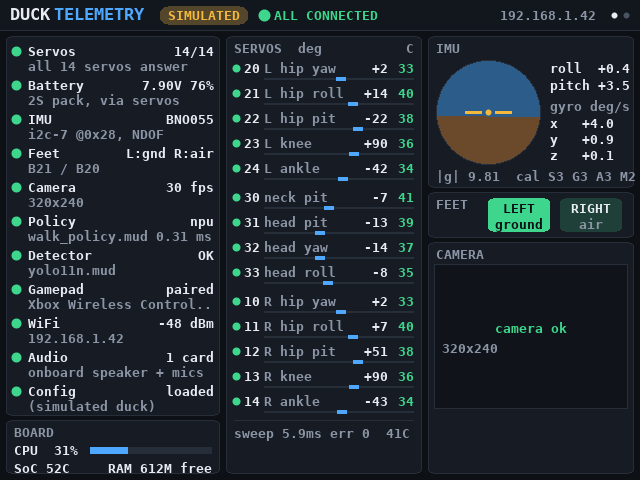
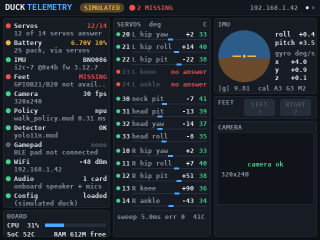
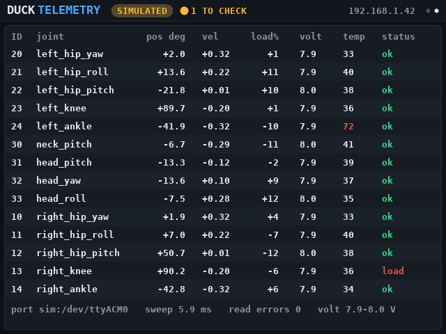
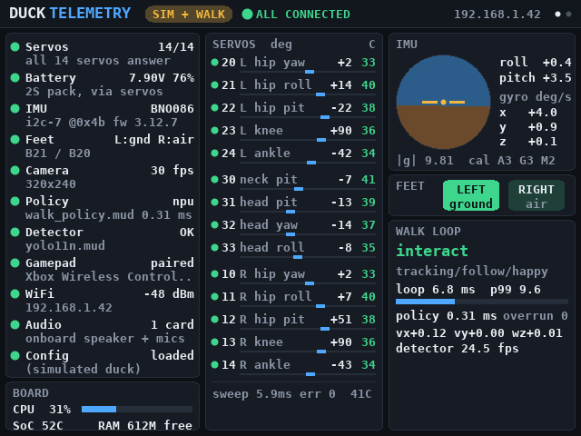
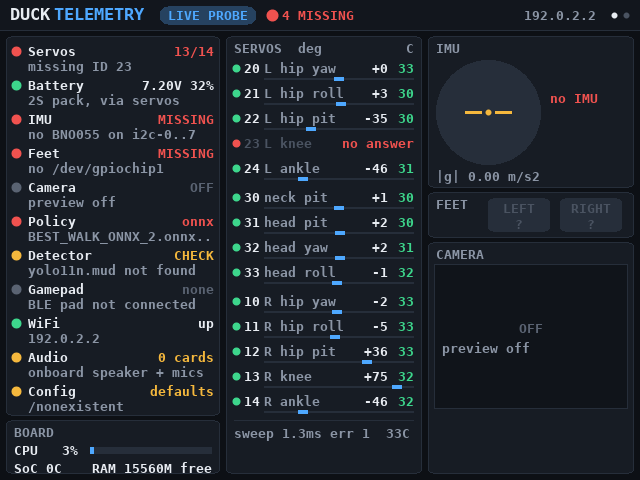

# duck_dash: live telemetry on the MaixCAM2 screen

A native app that shows, on the MaixCAM2's own screen, whether each part of the duck is connected and what it reads right now: the 14 servos, the battery, the BNO086, the foot switches, the camera, the walking policy on the NPU, the person detector, the gamepad, WiFi, audio and the board itself.



Each line has a dot: green is connected and reading normally, amber needs a look, red is missing or failing, grey is off or not applicable. The header sums it up ("ALL CONNECTED", "2 MISSING", ...). Tap anywhere to switch to the servo table; tap the title to exit.

| Faults (servos 23 and 24 unplugged, low battery, feet not wired) | Servo table |
|---|---|
|  |  |

## What it reads, and how

The app never turns servo torque on and never writes servo registers. It only reads.

| Panel | Source | Connected when |
|---|---|---|
| Servos | Feetech bus on `maixcam2.servo_port`, one 8-byte read per servo (position, velocity, load, voltage, temperature, status bits) | every ID in `odm_maix/hwi.py` answers. Missing IDs are listed and retried every 2 s. |
| Battery | average supply voltage the servos report (the 2S pack) | 7.0 V or more (amber below 7.0, red below 6.4, as in `diagnose.py`) |
| IMU | BNO086 (BNO08x) on `/dev/i2c-N` (`imu_i2c_bus`, or a scan of 0..7 at 0x4B/0x4A) | chip answers its Product ID request, streams accel + gyro reports, and gravity reads 8.8 to 10.8 m/s². Same axis remap as `odm_maix/imu.py` (`imu_upside_down`, `imu_axis_remap`). The only writes are SH-2 report requests; the chip is reset only if it does not answer. |
| Feet | `/dev/gpiochipN` lines for `left_foot_gpio` / `right_foot_gpio` (B21 is chip 1 line 21) | both lines read. A closed switch reads as "ground". |
| Camera | live 320x240 preview | frames arrive |
| Policy | `policy_path`; a `.mud` is loaded on the NPU once at start and timed on a zero observation | the model loads and takes 101 inputs |
| Detector | `vision.model_path` and the `.axmodel` its `.mud` names | the files exist (only needed for `--follow` / `--interact`) |
| Gamepad, WiFi, Audio, Board | `/proc/bus/input/devices`, `getifaddrs` + `/proc/net/wireless`, `/proc/asound/cards`, `/proc/stat`, thermal zones, `/proc/meminfo`, `/proc/ax_proc/mem_cmm_info` | |

### While the duck walks

`scripts/walk.py` owns the servo bus, the IMU and the foot switches while it runs, so the dashboard must not touch them. The walk loop now publishes a small feed (`odm_maix/telemetry.py`, written to `/dev/shm/duck_telemetry` ten times a second) and the dashboard switches to it on its own: the header says **WALK LOOP**, the camera panel turns into loop timing, mode, behaviour state, commands and detector fps, and the servo panel shows the positions the policy sees.



The handover works in both directions:

- `walk.py` announces itself before it opens anything, and waits 0.3 s if the dashboard is running. The dashboard then lets go of the camera, the feet GPIOs, the IMU and the bus.
- When `walk.py` stops, the feed goes stale after 1 s and the dashboard goes back to reading the hardware.
- If the vision process draws on the screen (`screen_eyes` or `vision.show`), the dashboard stops drawing until the walk ends.
- Started without the feed (an older `walk.py`, or `--no_telemetry`), the dashboard sees that another process holds the servo port and shows "busy" instead of opening it.

The feed costs the walk loop about 0.1 ms every 5th step, plus one 2-byte servo read per second for the battery voltage (about 0.3 ms). Turn it off with `walk.py --no_telemetry`.

## Why C, and the one C++ file

Everything that runs every frame is C99: the Feetech, BNO086 and GPIO drivers (`main/src/core/hw.c`), the sampler thread (`sampler.c`), the renderer with its own anti-aliased font (`gfx.c`, `ui.c`), and the main loop (`app.c`). The sampler reads every device at 20 Hz in its own thread, so a slow or missing device never stalls the screen, which redraws at 15 fps from a copy of the latest readings. Drawing a full frame takes about 0.6 ms on a PC; the A53 is several times slower, which is still a small part of the 66 ms between frames.

`main/src/main_maixcdk.cpp` is C++ only because Sipeed's SDK for the screen, touch panel, camera, NPU and pin functions (MaixCDK) has no C API. It is about 200 lines, does no drawing or sampling, and only hands frames and touches to the C core. The MaixCAM2 display goes through the AX630C video-output driver rather than a plain Linux framebuffer, so there is no SDK-free way to light the screen reliably.

## Build and install (MaixCDK)

Every push that touches `apps/duck_dash` is built for the MaixCAM2 by GitHub Actions (`.github/workflows/duck_dash.yml`). Download the `duck_dash-maixcam2` artifact from the run to skip the local build: it holds `duck_dash_v1.0.0.zip` (the launcher app package) and `duck_dash_release/` (the binary and the libraries it ships). To build it yourself:

On a Linux PC:

```bash
git clone https://github.com/sipeed/MaixCDK ~/MaixCDK
pip install -U -r ~/MaixCDK/requirements.txt
export MAIXCDK_PATH=~/MaixCDK

cd apps/duck_dash
maixcdk build -p maixcam2      # the first build downloads the toolchain
maixcdk release -p maixcam2    # dist/duck_dash_v1.0.0.zip
```

Then either install it as a launcher app (it shows up as "Duck Telemetry"):

```bash
scp dist/duck_dash_v*.zip root@<board-ip>:/root/       # MaixCAM2 password: sipeed
ssh root@<board-ip> /maixapp/apps/app_store/app_store install /root/duck_dash_v1.0.0.zip
```

or copy `dist/` over and run it from SSH, after closing the launcher (connect MaixVision, or kill `launcher_daemon`):

```bash
scp -r dist/ root@<board-ip>:/root/duck_dash
ssh root@<board-ip> 'cd /root/duck_dash/duck_dash_release && ./duck_dash'
```

Options (`./duck_dash --help`):

```
--config PATH       duck_config.json (default ~/duck_config.json)
--servo-port PATH   override maixcam2.servo_port
--imu-bus N         override maixcam2.imu_i2c_bus
--camera live|off   camera preview (default live; released while walk.py runs)
--no-bus --no-imu --no-feet   leave that hardware alone
--fps N             screen refresh rate (default 15)
--page N            start page (0 overview, 1 servo table)
--stats[=S]         print frame time, sampler rate and memory every S s (default 10)
```

To start it at boot next to the walk service, `duck_dash.service` here is a systemd unit (edit the path in `ExecStart`, then `cp duck_dash.service /etc/systemd/system/ && systemctl enable --now duck_dash`). It runs at low priority so it never competes with the 50 Hz loop. The Sipeed launcher also owns the screen, so use this together with `setup_board.sh apply --autostart`, which turns the launcher off.

## On a PC, without the board

```bash
cd apps/duck_dash
make                  # build/duck_dash, plain C, no SDK
make test             # C unit tests
make snapshots        # the screenshots above, from a simulated duck
./build/duck_dash --sim=missing:23,lowvolt:6.6,no_imu --frames 3 --snapshot out.ppm --dump
```

`--sim` faults: `missing:ID`, `lowvolt:V`, `hot:ID`, `overload:ID`, `no_bus`, `no_imu`, `no_feet`, `no_camera`, `no_npu`, `no_pad`, `walk` (pretend `walk.py` is running).

To test the real servo driver without servos, `tools/pty_duck.py` serves the same wire-level simulated duck that `diagnose.py --dry-run` uses on a pseudo-terminal:

```bash
python3 tools/pty_duck.py --fault missing:23,hot:24     # prints /dev/pts/N
./build/duck_dash --servo-port /dev/pts/N --frames 20 --dump
```



`tests/test_duck_dash.py` (run by `pytest` from the repo root) does this, plus the walk-loop feed and the C unit tests.

### Stress testing with a simulated duck

`tools/duck_stress.py` makes up a whole duck (14 servos with position, velocity, load, voltage, temperature and status bits, the BNO086's gravity and gyro, both feet, a 2S pack that discharges, policy timing and step count, detector fps) and changes it over time. It only needs the Python 3 standard library, so the same file runs on a PC and on the MaixCAM2.

It reaches the dashboard through one of two sinks:

- **feed** (default) rewrites `/dev/shm/duck_telemetry`, the file `walk.py` publishes. A running dashboard switches to it on its own, so this works on the board with the installed app and no other change. The feed also carries optional per-servo lines (`present`, `load`, `temp`, `svolt`, `err`, and `steps`) that `walk.py` does not write; the dashboard shows them when they are there.
- **bus** serves a Feetech servo bus on a pseudo-terminal, to push the real C servo driver through dropouts, garbage bytes, bad checksums, half packets, replies from the wrong ID and late replies. Start the dashboard with `--servo-port` set to the path it prints.

| Scenario | What it does |
|---|---|
| `nominal` | a duck walking, nothing wrong |
| `faults` | every fault the dashboard knows, 3 s each: servos unplugged (one, a leg, all), hot servos, status error bits, low and critical battery, IMU missing / 0 g / upside down, feet missing, bus errors climbing, loop overruns, slow policy, paused |
| `disconnect` | the feed goes stale, disappears, comes back, flaps around the 1 s limit, `walk.py` "starting" handovers, clock skew |
| `extreme` | NaN, inf, huge and negative values, too many or too few numbers, binary garbage, over-long lines and strings, empty files |
| `rate` | rewrites the feed 1000 times a second |
| `soak` | `nominal` with rare random faults, for hours |
| `chaos` | a random one of the above every 1 to 3 s |

```bash
python3 tools/duck_stress.py -s faults                    # watch the dashboard react
python3 tools/duck_stress.py -s soak --discharge-min 120  # long run, pack empties over 2 h
python3 tools/duck_stress.py --sink bus -s chaos          # prints /dev/pts/N
./build/duck_dash --servo-port /dev/pts/N --no-imu --no-feet --stats
```

`--stats[=S]` makes the dashboard print, every S seconds (default 10), its frame rate, draw time (mean/max), sampler rate, source switches and resident memory, plus a summary at exit. `make stress` builds the dashboard with AddressSanitizer and UBSan and runs it headless against every scenario on both pages, failing on a crash, a sanitizer report or a stalled sampler; `make stress-host` does the same on the plain build and also fails if memory keeps growing. `STRESS_SECS=60 make stress` runs each one longer.

On the board, copy the two files over and run it while the dashboard is on screen (`walk.py` must not be running, since it writes the same feed):

```bash
scp tools/duck_stress.py tools/stress.sh root@<board-ip>:/root/
ssh root@<board-ip> python3 /root/duck_stress.py -s chaos --duration 600
```

or, with the launcher closed, `sh /root/stress.sh <path to duck_dash> 60` runs the same checks as `make stress-host` on the board.

`make aarch64` cross-compiles the plain C build for the MaixCAM2 (`aarch64-linux-gnu-gcc`, static). It reads all the same hardware but has no camera, NPU test or pin functions, and draws only if there is a usable `/dev/fb0` (`--fb`). It is mainly useful as a headless checker over SSH: `./duck_dash --frames 40 --dump`.

## Not verified on hardware yet

This was built and tested on a PC: the C core against the simulated duck, the MaixCDK shim compiled against the MaixCDK headers, and the aarch64 build under QEMU. Things to check on the first run on the board:

- the dashboard fills the panel the right way round (it renders 640x480 and lets MaixCDK fit it to the screen)
- tapping switches pages (MaixCDK touch coordinates)
- the camera preview at 320x240 works next to the NPU probe
- the BNO086 reads over `/dev/i2c-7` once the dashboard has set the A8/A9 pin functions (the C SHTP driver is unit-tested on parsed packets, not yet against a chip)
