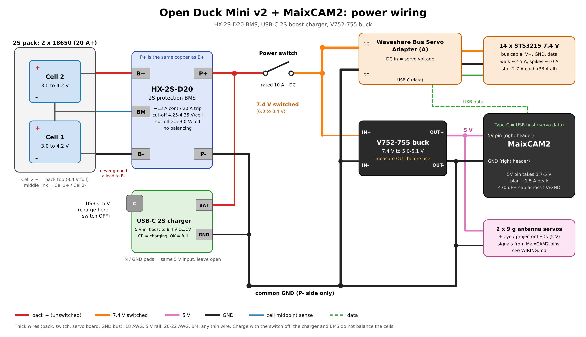

# Power: battery, BMS, charger and 5 V buck

This page covers the power side of the duck with the three boards on hand: an **HX-2S-D20** BMS, a **USB-C 2S boost charger** and a **V752-755** buck module. Pins and signals are in [WIRING.md](WIRING.md); this page only deals with power.

The diagram source is [images/power-wiring.svg](images/power-wiring.svg).

## Power parts against the v2 BOM

The [Open Duck Mini v2 BOM](https://docs.google.com/spreadsheets/d/1gq4iWWHEJVgAA_eemkTEsshXqrYlFxXAPwO515KpCJc/edit?usp=sharing) has eight lines in its "Power" group. This is how the boards on hand map to them.

| v2 BOM line | Board on hand | Status |
|---|---|---|
| 18650 cell x2 (Molicel P30B, 3000 mAh, 30 A) | none yet | **Still needed.** Use cells rated 20 A or more. Charge both to the same voltage before fitting them. |
| 18650 2S cell holder | none yet | Still needed. |
| 2S BMS | **HX-2S-D20** | Matches. |
| 5V regulator (HENGE UBEC, 4 to 12 A) | **V752-755 buck** | Replaces the UBEC. Check its output and current first (see below). |
| Small power switch | none yet | Still needed. It carries all the servo current. |
| usb-c charger | **USB-C 2S boost charger** | Matches. Upstream buys a cased version of the same circuit. |
| 2.1 mm barrel jack x2 | none yet | One plugs into the servo board's DC input. The second is only needed if the charger stays outside the body. |
| XT30 pair | none yet | Optional. It lets you unplug the pack from the BMS. |

## The three boards

### HX-2S-D20: 2S protection board

| Pad | Goes to |
|---|---|
| **B-** | Cell 1 negative (pack bottom) |
| **BM** | The middle link, where Cell 1 + meets Cell 2 - |
| **B+** | Cell 2 positive (pack top, 8.4 V when full) |
| **P+** | Pack output +. On this board P+ is the same copper as B+; the protection MOSFETs switch the negative side. |
| **P-** | Pack output -. **Every load and the charger ground go here, never to B-.** |

Seller specs (no manufacturer datasheet): 4.25 to 4.35 V per cell overcharge cut-off, 2.5 to 3.0 V per cell over-discharge cut-off, about 13 A continuous and a 20 A over-current trip. One listing sells the same board name as 8 A, so treat 13 A as the upper bound. It does not balance the cells.

Solder order: B- first, then BM, then B+. A wrong BM wire puts a full cell across the wrong pads.

### USB-C 2S boost charger

Takes 5 V from USB-C (the **IN**/**GND** pads next to the connector are the same 5 V input) and boosts it to an 8.4 V constant-current, constant-voltage charge on **BAT**/**GND**. **CR** lights while charging and **OK** when the pack is full. Plain 5 V only, no USB-PD, so any phone charger works.

The charge current depends on the version (1 A, 2 A or 4 A *input*); the battery side gets about half of that. The version is usually printed on the back. At 0.5 to 1 A into a 3000 mAh pack, a full charge takes 3 to 6 hours.

Wire **BAT** to **P+** and **GND** to **P-**, on the battery side of the power switch. The BMS then still catches an overcharge, and the duck charges with the switch off. Don't run the duck while charging: the duck draws more than the charger gives, so the charger never reaches the full mark.

### V752-755 buck converter

A small step-down module with doubled pads: **IN+**, **IN-**, **OUT+**, **OUT-**, with the arrow pointing from input to output. "V752-755" is a PCB revision, not a part number, and no datasheet turned up for it. The layout matches the common fixed-output "Mini560"-style modules (5 V out, 3 A continuous, 5 A peak), but the output voltage and current need to be confirmed on the bench:

1. Feed IN+/IN- from the 2S pack (or a 7.4 V bench supply) with nothing on the output.
2. Measure OUT+/OUT-. It must read **4.9 to 5.2 V**. If it reads 3.3, 9 or 12 V, it is a different version: don't connect it.
3. If the board has a trim pot or solder jumpers on the component side, set 5.0 to 5.1 V.
4. Load it with about 2 A (a USB load tester or a 2.5 ohm, 10 W resistor) for a few minutes. It should stay above 4.8 V and be warm, not hot.

## Mismatches to check

1. **Servo voltage: fine.** The v2 BOM uses the **7.4 V STS3215** (19 kg.cm), and the upstream duck feeds them straight from 2S, which is 8.4 V full and about 6.6 V flat. `docs/BRINGUP.md` already expects 7.0 to 8.5 V on the bus. Don't feed the servo board through the buck, and don't buy the 12 V STS3215.
2. **BMS current vs. servo stall: tight, but the same as upstream.** Walking draws about 2 to 5 A, with spikes near 10 A. One STS3215 stalls at about 2.7 A, so 14 stalling at once (a fall, or standing up against the floor) is close to 38 A. The HX-2S-D20 trips at about 20 A. When it trips, *everything* goes off, MaixCAM2 included, and it resets once the load is removed. This is a feature for the gears, but it means a hard fall reboots the brain. If that happens often, use a 2S BMS rated 30 A or more; the cells are already good for 30 A.
3. **Buck current vs. 5 V load: confirm the rating.** The 5 V rail feeds the MaixCAM2 (plan about 1.5 A peak with NPU, camera, WiFi and screen running; Sipeed has not published a figure), the two 9 g antenna servos (up to about 0.7 A each when stalled) and the LEDs. That is about 3 A at worst, which is why `WIRING.md` asks for a UBEC of 3 A or more. A Mini560-class buck is fine. If yours turns out to be a 2 A part (MP1584-class), power the antenna servos from a second buck.
4. **Brown-out on the 5 V rail.** When the servos pull the pack down, the buck input drops too. A 5 V buck stays in regulation down to about 6 V in, and the MaixCAM2 5V pin accepts down to 3.7 V, so this should hold. Put a 470 µF (or larger) 10 V+ capacitor across the MaixCAM2 5V and GND pins anyway, and keep the 5 V wires short.
5. **No cell balancing.** Neither the BMS nor the charger balances. Check both cell voltages every few charges: measure B- to BM (Cell 1) and BM to B+ (Cell 2). If they differ by more than 0.05 V, charge the low cell on its own with a 1S charger.
6. **Switch rating.** The power switch sits in the full servo current path. Use one rated 10 A DC or more, or switch a relay or MOSFET with a small switch.
7. **Charger drain.** With the charger always connected to the pack, check the pack doesn't run down over a week with the switch off. If it does, move the charger behind a barrel jack (upstream's way) so it is only connected while charging.

## Wiring list

| From | To | Wire |
|---|---|---|
| Cell 1 - | BMS **B-** | 18 AWG |
| Cell 1 + / Cell 2 - link | BMS **BM** | thin (26 AWG is fine) |
| Cell 2 + | BMS **B+** | 18 AWG |
| BMS **P+** | charger **BAT**, and power switch in | 18 AWG to the switch |
| BMS **P-** | charger **GND**, and the common GND bus | 18 AWG |
| Power switch out (7.4 V switched) | servo board DC + (barrel jack), buck **IN+** | 18 AWG to the servo board, 22 AWG to the buck |
| GND bus | servo board DC -, buck **IN-** | same as above |
| Buck **OUT+** | MaixCAM2 **5V** pin (right header), antenna servo V+, LED supply | 20 to 22 AWG |
| Buck **OUT-** | MaixCAM2 **GND** (right header), antenna servo GND, LED GND | 20 to 22 AWG |
| Servo board USB-C | MaixCAM2 Type-C (USB host) | data only |

## First power-up

1. With no cells fitted, check for shorts: P+ to P-, 7.4 V bus to GND, and 5 V to GND.
2. Fit the cells. Measure B+ to B- (6.0 to 8.4 V) and B- to BM (3.0 to 4.2 V). Measure P+ to P-: some protection boards read 0 V until a charger is connected once. Plug USB-C in for a second to wake it.
3. Bench-check the buck as described above, with the MaixCAM2 unplugged.
4. Connect the MaixCAM2, switch on, and check it boots. Then connect the servo board.
5. Charge once fully and confirm OK lights and the pack reads 8.3 to 8.4 V.
6. Run `python3 scripts/diagnose.py --only servo` and check `servo.power` reads 7.0 to 8.5 V.
