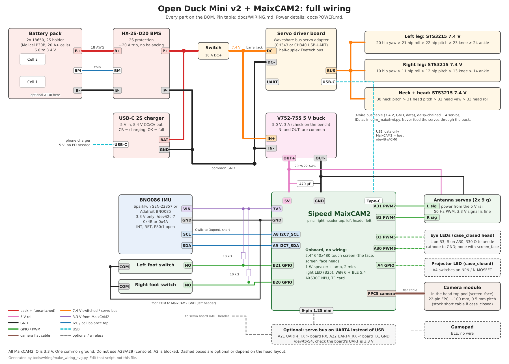
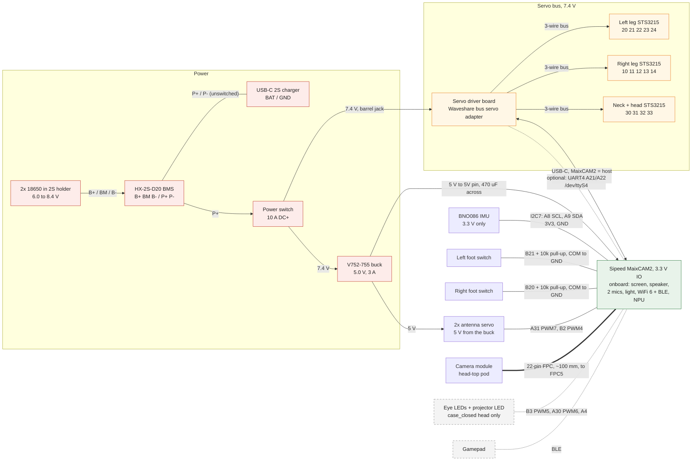
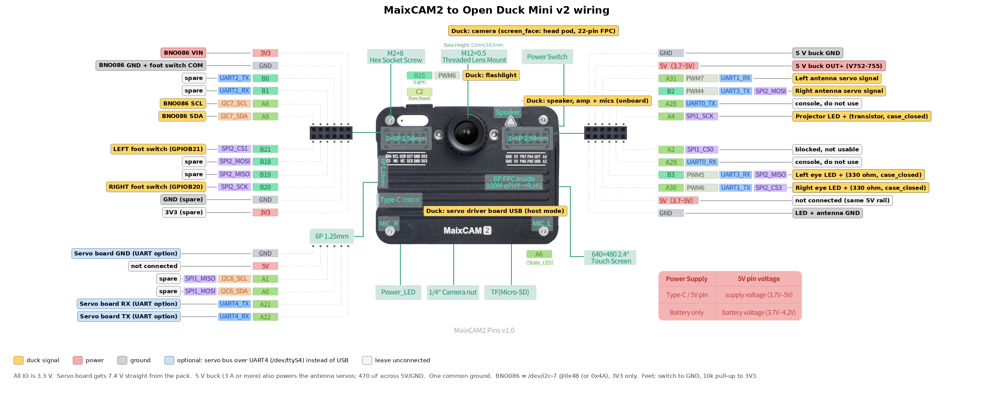

# Wiring the MaixCAM2 into Open Duck Mini v2

This replaces the [Pi Zero pin table](https://github.com/apirrone/Open_Duck_Mini/blob/v2/docs/assembly_guide.md#electronics) in the v2 assembly guide. Everything else in the v2 build (battery pack, BMS, servo driver board, servos, foot switches) stays as it is, with three changes: a **BNO086** breakout in place of the BNO055 (see [BOM.md](BOM.md)), a 5 V buck in place of the UBEC (see [POWER.md](POWER.md)), and a head that holds the MaixCAM2, with its screen as the face and the camera on top (see `hardware/head_maixcam2`).

Pin names come from Sipeed's [MaixCAM2 pinout](https://wiki.sipeed.com/hardware/assets/maixcam/maixcam2_pins.jpg) and the MaixPy [pinmap](https://wiki.sipeed.com/maixpy/doc/en/peripheral/pinmap.html), [UART](https://wiki.sipeed.com/maixpy/doc/en/peripheral/uart.html), [I2C](https://wiki.sipeed.com/maixpy/doc/en/peripheral/i2c.html) and [PWM](https://wiki.sipeed.com/maixpy/doc/en/peripheral/pwm.html) pages. Every pin name, function and `/dev` path here was checked against the MaixCDK pinmap source (`components/peripheral/port/maixcam2/maix_pinmap.cpp`) and the MaixPy peripheral docs. The pin functions at boot are read from hardware, so run `python3 scripts/find_pins.py` once before you solder.

## The whole duck

[](images/duck-wiring.svg)

Every part on the BOM, with power, servos, sensors, LEDs and the camera on one sheet. Click it to open it full size; it is an SVG, so it stays sharp when you zoom in. It is drawn by [`tools/wiring/make_wiring_svg.py`](../tools/wiring/make_wiring_svg.py) (plain Python, no dependencies): change a wire there, run `python3 tools/wiring/make_wiring_svg.py`, and the change shows up as a text diff in the pull request instead of a new binary image.

The same connections as a [Mermaid](https://docs.github.com/en/get-started/writing-on-github/working-with-advanced-formatting/creating-diagrams) chart, which GitHub draws straight from the text below (you can pan and zoom it on github.com):



## Every part on the BOM

The [v2 BOM](https://docs.google.com/spreadsheets/d/1gq4iWWHEJVgAA_eemkTEsshXqrYlFxXAPwO515KpCJc/edit?usp=sharing) with the changes in [BOM.md](BOM.md), and where each line is wired.

| Part | Qty | Connects to | Details |
|---|---|---|---|
| Sipeed MaixCAM2 (no battery version) | 1 | 5V/GND from the buck, USB-C to the servo board, headers to everything below | [Wiring table](#wiring-table) |
| 18650 cells (Molicel P30B or other 20 A+) + 2S holder | 2 + 1 | BMS B+, BM, B- | [POWER.md](POWER.md#hx-2s-d20-2s-protection-board) |
| HX-2S-D20 2S BMS | 1 | P+ to the switch and charger BAT; P- to the common ground | [POWER.md](POWER.md#hx-2s-d20-2s-protection-board) |
| USB-C 2S boost charger | 1 | BAT/GND to BMS P+/P-, before the switch | [POWER.md](POWER.md#usb-c-2s-boost-charger) |
| Power switch, 10 A DC or more | 1 | BMS P+ in, 7.4 V switched bus out | [POWER.md](POWER.md#mismatches-to-check) |
| 2.1 mm barrel jack | 1 (2 if the charger stays outside) | 7.4 V bus to the servo board DC input | |
| XT30 pair | 1 (optional) | between the pack and the BMS | |
| V752-755 5 V buck (replaces the UBEC) | 1 | IN from the 7.4 V bus; OUT to MaixCAM2 5V, antenna servos, LEDs | [POWER.md](POWER.md#v752-755-buck-converter) |
| 470 µF 10 V+ capacitor | 1 | across MaixCAM2 5V and GND | [POWER.md](POWER.md#mismatches-to-check) |
| Servo driver board (Waveshare bus servo adapter) | 1 | 7.4 V DC in, servo bus out, USB-C to the MaixCAM2 | [Servo bus](#servo-bus-usb-or-uart) |
| STS3215 servos, **7.4 V** version | 14 | daisy-chained on the bus: left leg 20 to 24, right leg 10 to 14, neck and head 30 to 33 | `odm_maix/hwi.py` |
| BNO086 breakout (replaces the BNO055) | 1 | 3V3, GND, A8 SCL, A9 SDA | [BOM.md](BOM.md#about-the-bno086) |
| Qwiic / STEMMA QT to female Dupont cable | 1 | BNO086 to the left header | |
| Foot switches | 2 | B21 (left) and B20 (right), COM to GND | |
| 10 kΩ resistors | 2 | B21 to 3V3, B20 to 3V3 | |
| Antenna servos (9 g) | 2 | signal on A31 (left) and B2 (right), power from the 5 V rail | |
| Eye LEDs + 330 Ω resistors | 2 + 2 | B3 (left), A30 (right). **`case_closed` head only**: the `screen_face` head uses the screen as the face | |
| Projector LED (+ NPN or N-MOSFET) | 1 | A4. **`case_closed` head only** | |
| Camera module (onboard, moved) + 22-pin flat cable, ~100 mm | 1 | MaixCAM2 camera connector (FPC5). With the `screen_face` head it sits in a pod on the head top; with `case_closed` it stays on the stock short cable | `hardware/head_maixcam2/README.md` |
| Right-angle Dupont plugs | ~10 | both 2x6 headers: the plugs point back into the head and there is only 8 mm before the neck | |
| Speaker, amplifier, microphones, flashlight | 0 | onboard the MaixCAM2 | |
| Gamepad | 1 | BLE, no wire | |

## Header pinout

This picture shows each MaixCAM2 pin with its alternate functions and what the duck puts on it.



## Rules

- **All MaixCAM2 IO is 3.3 V.** Never put 5 V or 7.4 V on a signal pin.
- **Power goes into the 5V header pin**, which accepts 3.7 to 5 V and is the same rail as the Type-C port. Feed it from the duck's 5 V buck (see [POWER.md](POWER.md)); a UBEC works too.
- **One common ground** between the battery, 5 V buck, servo driver board and MaixCAM2.
- **Do not use `A28`/`A29` (UART0).** That is the Linux console and boot log.
- **`A2` cannot be used.** Sipeed blocks that hole on purpose so the header can't be plugged in the wrong way.

## The three connectors

The MaixCAM2 has two 2x6 2.54 mm headers and one 6-pin 1.25 mm connector. Pins are listed in the order of Sipeed's pinout diagram:

```
   LEFT 2x6 header (body sensors)               RIGHT 2x6 header (power + head)
   ---------------------------------            ---------------------------------
   3V3  -> BNO086 3V3/VIN                       GND  <- buck GND
   GND  -> BNO086 GND, foot switch common       5V   <- buck 5V out
   B0   (UART2_TX)  spare                       A31  PWM7 -> left antenna signal
   B1   (UART2_RX)  spare                       B2   PWM4 -> right antenna signal
   A8   I2C7_SCL -> BNO086 SCL                  A28  UART0_TX  (console, do not use)
   A9   I2C7_SDA -> BNO086 SDA                  A4   GPIO   -> projector LED
   B21  GPIO in  <- left foot switch            A2   (blocked)
   B18  (SPI2_MOSI) spare                       A29  UART0_RX  (console, do not use)
   B19  (SPI2_MISO) spare                       B3   PWM5   -> left eye LED
   B20  GPIO in  <- right foot switch           A30  PWM6   -> right eye LED
   GND                                          5V   (second 5V pin, same rail)
   3V3                                          GND

   6-pin 1.25 mm connector (optional servo UART)
   ---------------------------------
   GND, 5V, A1 (I2C6_SCL), A0 (I2C6_SDA), A21 UART4_TX, A22 UART4_RX
```

The header silkscreen shows the same pins in two rows, so match by name, not by the row order above.

## Wiring table

| Part | Part pin | MaixCAM2 pin | Function (`maix.pinmap`) | Notes |
|---|---|---|---|---|
| **Power (5 V buck)** | OUT+ | 5V (right header) | power in | V752-755 buck (or a UBEC), 3 A or more. Also feeds the antenna servos. 470 µF across 5V and GND. |
| | OUT- | GND (right header) | | |
| **Servo driver board** (Waveshare bus servo adapter) | USB | Type-C | USB host, `/dev/ttyACM0` | Default. Set the MaixCAM2 USB mode to **host** (Settings → USB Mode, or `maix_usb_mode=host`). A CH343-based board shows up as `/dev/ttyACM0`, a CH340-based one as `/dev/ttyUSB0`. The board keeps its own 7.4 V DC input from the battery. |
| | *or* UART RX | A21 (6-pin) | `UART4_TX`, `/dev/ttyS4` | Optional, see below. |
| | *or* UART TX | A22 (6-pin) | `UART4_RX` | |
| | *or* GND | GND (6-pin) | | |
| **BNO086** (BNO08x breakout, e.g. SparkFun VR IMU SEN-22857; an Adafruit BNO085 works too) | 3V3 / VIN | 3V3 (left header) | | **3.3 V only**: the chip's limit is 3.6 V and some BNO086 boards have no regulator. The breakout pull-ups then sit at 3.3 V, which is what the MaixCAM2 needs. A Qwiic/STEMMA QT to female Dupont cable fits the header. |
| | GND | GND (left header) | | |
| | SCL | A8 | `I2C7_SCL` | `/dev/i2c-7`, address **0x4B** (SparkFun default) or **0x4A** (ADR/DI jumper, Adafruit default). The runtime scans both. |
| | SDA | A9 | `I2C7_SDA` | |
| | INT, RST | not connected | | The driver polls, so INT is not needed. Breakouts pull RST high; if yours doesn't, tie RST to 3V3. |
| | PS0, PS1 | not connected | | Must read low for I2C; breakouts pull them down (SparkFun: leave the PS jumpers open). |
| **Left foot switch** | NO contact | B21 | `GPIOB21` | 10 kΩ pull-up from B21 to 3V3 (`maix.gpio` does not enable an internal pull-up on inputs). Closed = foot on the ground. |
| | COM | GND (left header) | | |
| **Right foot switch** | NO contact | B20 | `GPIOB20` | 10 kΩ pull-up from B20 to 3V3. |
| | COM | GND (left header) | | |
| **Left antenna servo** | signal | A31 | `PWM7`, 50 Hz | 3.3 V signal is fine for hobby servos. Power from the buck 5 V, not from a MaixCAM2 pin. |
| **Right antenna servo** | signal | B2 | `PWM4`, 50 Hz | |
| | 5V, GND | buck 5 V, GND | | |
| **Left eye LED** (`case_closed` head) | anode (+) through 330 ohm | B3 | `PWM5` or `GPIOB3` | PWM gives dimming. Not fitted with the `screen_face` head, where the screen is the face. |
| **Right eye LED** | anode (+) through 330 ohm | A30 | `PWM6` or `GPIOA30` | `PWM6` is shared with the onboard light (`B25`), so use one or the other as PWM. |
| **Projector LED** (`case_closed` head) | anode (+) | A4 | `GPIOA4` | Brighter LED: switch it with an NPN or N-MOSFET from 5 V instead of driving it from the pin. |
| | common cathode (-) | GND | | |
| **MAX98357A + speaker** | | not needed | | The MaixCAM2 has an onboard amplifier and 1 W speaker (`maix.audio`). |
| **Microphone** | | not needed | | Two onboard mics. |
| **Camera module** | 22-pin flat cable | camera connector (FPC5) | | The onboard camera. With the `screen_face` head it moves to a pod on the head top on a ~100 mm 22-pin flat cable; check the stock cable's pitch and contact sides and buy the same type. With `case_closed` it stays on its stock cable. |
| **Flashlight** | | not needed | | The onboard light LED on `B25`. |
| **Gamepad** | | Bluetooth | | The MaixCAM2 radio is WiFi 6 + BLE 5.4, so use a controller that pairs over BLE (recent Xbox Wireless Controller firmware does). Not tested yet. |

## Servo bus: USB or UART

**Start with USB.** It is what the v2 duck already uses, it needs no soldering, and the servo driver board handles the half-duplex bus. The Type-C port becomes the servo link, which is why the MaixCAM2 has to be powered from the 5V header pin. Use WiFi and SSH to reach the board.

**Move to UART4 later** if you want the Type-C port back, or if USB turns out flaky. The MaixCAM2 UART clock is 200 MHz and its divider has 1/16 steps, so 1 Mbps (200 MHz / (16 x 1 Mbps) = 12.5) is set exactly. Sipeed has only tested 115200 baud, so check the bus with `check_motors.py` after switching. Before you wire it, check that the driver board's UART header is 3.3 V logic and set its mode jumper to UART. Cross TX and RX, then set:

```json
"servo_port": "/dev/ttyS4",
"pinmap": {"A8": "I2C7_SCL", "A9": "I2C7_SDA", "A21": "UART4_TX", "A22": "UART4_RX"}
```

`pinmap` in `duck_config.json` replaces the default one, so keep the I2C entries in it.

## Power

The power side is on the [whole-duck diagram](#the-whole-duck) above:

- 2x 18650 into the HX-2S-D20 BMS (B+, BM, B-).
- BMS P+/P- to the USB-C 2S charger (BAT/GND), unswitched, and to the power switch.
- The switched 7.4 V goes straight to the servo driver board (the STS3215s are the 7.4 V version) and to the 5 V buck.
- The buck's 5 V feeds the MaixCAM2 5V pin, the antenna servos and the LEDs.

This is the v2 layout with the Pi swapped out. The MaixCAM2 draws more than a Pi Zero 2W when the NPU and camera run, so use a buck (or UBEC) rated 3 A or more. [POWER.md](POWER.md) has the full power wiring with an HX-2S-D20 BMS, a USB-C 2S charger and a small buck module, and what to check on each. The battery version of the MaixCAM2 has its own charger. Don't fit a cell to it inside the duck, because the duck already has a pack.

## Check it

```bash
python3 scripts/find_pins.py      # every pin above lists the function in the table
python3 scripts/test_imu.py       # BNO08x on i2c-7 @0x4b (or 0x4a), firmware x.y.z
python3 scripts/test_feet.py      # press each foot, the right side changes
python3 scripts/check_motors.py   # all 14 servos answer
```
