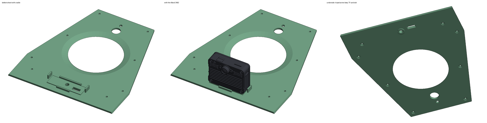

# Head for the MaixCAM2

A modified Open Duck Mini v2 head that carries the [Sipeed MaixCAM2](https://wiki.sipeed.com/hardware/en/maixcam/maixcam2.html) behind the face, with the lens looking out between the eyes. Print these two files instead of the upstream ones; every other head part (eyes, bulb, flash light, antennas, speaker, neck) is unchanged.

| Print this | Instead of (upstream `print/`) |
|---|---|
| [`stl/head_maixcam2.stl`](stl/head_maixcam2.stl) | `head.stl` |
| [`stl/head_bot_sheet_maixcam2.stl`](stl/head_bot_sheet_maixcam2.stl) | `head_bot_sheet.stl` |

Same print settings as upstream (PLA, 15% infill). The STLs are in the same coordinate frame as the upstream print files, so place them on the bed the way you placed the originals.




## What changed

- **The head is 18 mm longer at the front.** The board is 21.2 mm deep and the header plugs need room in front of it, and the stock face sits too close to the neck's `head_roll_mount` for both. The head is cut where its walls are straight (x = 110 mm) and the front, with the face, eye mounts and screw bosses, moves forward unchanged. The stock eyes and bulb fit as before.
- **Camera window in the face.** The Pi camera bosses behind the face are removed, and a tapered window is cut in front of the lens, sized for the lens's full 86.7° × 56° (16:9) field of view. The build checks that nothing in the head or the eyes blocks it.
- **Power-switch slot** in the top of the head, above the board's switch.
- **Cradle on the bottom sheet.** The board stands on a 1.5 mm pad, with fences at the sides and back so it can't turn. One 1/4"-20 screw goes up through the sheet into the board's tripod nut. A slot under the TF card lets you swap the card from below without opening the head.

The screen faces into the head, so you can't see it once the head is closed. `duck_dash` is still useful on the bench with the bottom sheet off.

## Fit (from `stl/build_report.json`)

All clearances are checked against Sipeed's official MaixCAM2 STEP model and the upstream parts:

| Check | Result |
|---|---|
| Board, lens, 8 mm of header plugs vs head, sheet, roll mount, neck, speaker, flash, eyes | no overlap |
| Board back to `head_roll_mount` | 2.75 mm |
| Board top to the inside of the head top | 1.0 mm |
| Front cover to the inside of the face (room for header plugs) | 11 mm, 8 mm of it clear of the eye mounts |
| Camera view blocked, 16:9 and 4:3 | 0% |
| Tripod screw thread in the nut (3/8" screw, nut is 4.56 mm deep) | 4.0 mm |
| Extra plastic vs stock (head + sheet) | +41 cm³ solid volume, roughly +30–50 g printed |

## Parts and assembly

- 1 × 1/4"-20 × 3/8" (9.5 mm) camera screw. A longer one bottoms out in the nut.
- **Right-angle (90°) Dupont plugs** on the two 2×6 headers. The headers face forward, toward the face, and there is about 8 mm in front of them before the eye mounts. Straight plugs need about 15 mm, so they don't fit unless you rebuild with `--plug-gap 16 --extend 23`.
- The Type-C port (servo board USB) and the 6-pin 1.25 mm connector are on the duck's right side of the board. There are about 45 mm to the side wall, so a straight Type-C plug fits.

1. Screw the MaixCAM2 onto the bottom sheet with the lens toward the front.
2. Plug in the header wires and the Type-C cable (see [docs/WIRING.md](../../docs/WIRING.md)), and route them back past the board.
3. Close the head with the bottom sheet as on the stock duck. The lens lines up with the window.

## Camera position for the simulator

With this head, the front of the lens is at (129.8, 0, 154.1) mm in the upstream head frame. That is 9.8 mm ahead of and 15 mm above the centre of the stock face, or (0.025, 0, −0.069) m in the `head_assembly` body frame of the upstream `robot.xml`. If you train with the camera on the head, re-check `CameraConfig.head_pos` in `training/odm_train/camsim/scene.py` and weigh the board and screw for `--camera_mass_g`.

## Rebuilding

The upstream head only exists as STL exports from OnShape, so the build script edits those meshes directly. It does not rebuild a CAD model. Every dimension above is a parameter:

```bash
pip install -r requirements.txt
python build_head.py                     # downloads the inputs into .cache/, writes stl/ and images/
python build_head.py --extend 20 --plug-gap 13
python build_head.py --no-check          # parts only, no MaixCAM2 model needed (skips cadquery)
```

Inputs, downloaded on the first run:

- Upstream STLs from [apirrone/Open_Duck_Mini](https://github.com/apirrone/Open_Duck_Mini) `print/`, pinned to commit `b23317a` (Apache-2.0)
- Sipeed's MaixCAM2 3D model, `3D_MaixCAM2_2025-11-24.zip` from [dl.sipeed.com](https://dl.sipeed.com/shareURL/MaixCAM/MaixCAM2/Hardware/assemble_maixcam2). It is only used for the fit checks and the preview images, and is not committed here.

The script exits with an error if any part overlaps the board, the lens or the header plugs.

## Not yet tested

This has not been printed or test-fitted. The tightest spots are the 1 mm above the board and the 2.75 mm to the roll mount. If your printer runs over size, check those first.
