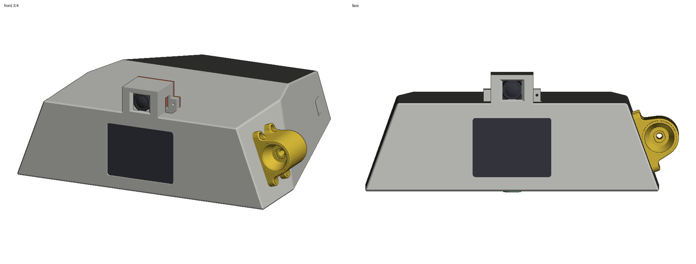
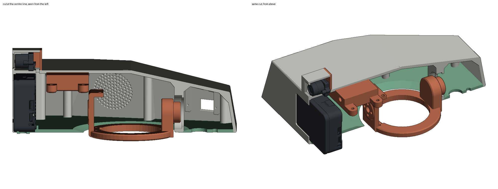
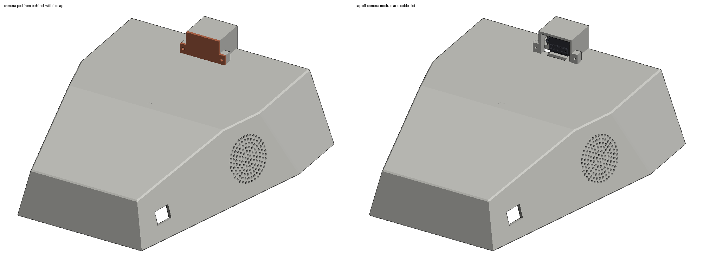
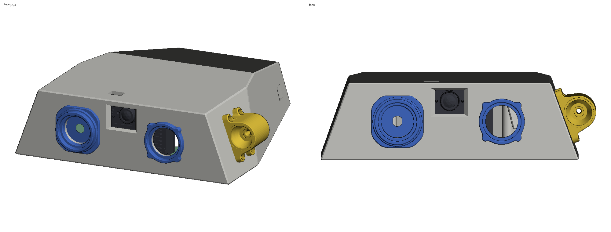
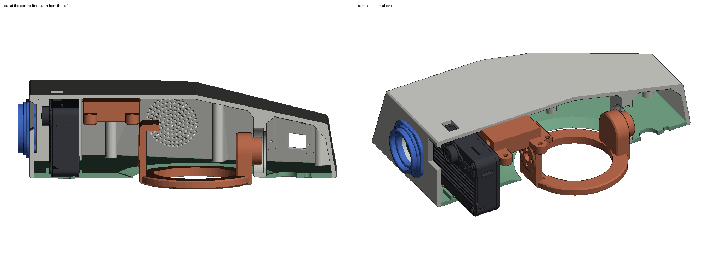
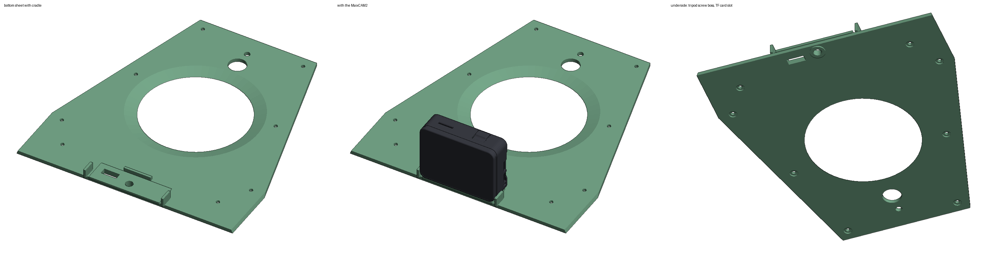

# Head for the MaixCAM2

Modified Open Duck Mini v2 heads that carry the [Sipeed MaixCAM2](https://wiki.sipeed.com/hardware/en/maixcam/maixcam2.html). There are two layouts. Both are built by the same script and checked against Sipeed's official 3D model of the board.

| Layout | Face | Camera | Board |
|---|---|---|---|
| **`screen_face`** (default) | The MaixCAM2 screen is the face, replacing the LED eyes | Camera module moved to a pod on top of the head, on a longer flat cable | Case opened once to move the camera, then closed again |
| **`case_closed`** | Stock LED eyes | Lens looks out between the eyes | Case stays closed. The screen faces into the head |

Same print settings as upstream (PLA, 15% infill). The STLs are in the same coordinate frame as the upstream print files, so place them on the bed the way you placed the originals. Every other head part (antennas, speaker, flash light, neck) is unchanged.

## Screen as the face (`screen_face`)

| Print this | Instead of (upstream `print/`) |
|---|---|
| [`stl/screen_face/head_maixcam2_screen.stl`](stl/screen_face/head_maixcam2_screen.stl) | `head.stl` (and you no longer need `left_eye`, `right_eye`, `bulb`) |
| [`stl/screen_face/head_bot_sheet_maixcam2.stl`](stl/screen_face/head_bot_sheet_maixcam2.stl) | `head_bot_sheet.stl` |
| [`stl/screen_face/camera_pod_cap.stl`](stl/screen_face/camera_pod_cap.stl) | new: closes the back of the camera pod |





**How it works**

- **The board faces backward.** The screen sits behind a 1 mm lip with a 53 × 40 mm window, so the whole 49 × 37 mm active area shows. The board is turned around its vertical axis, so the picture stays upright and no software rotation is needed. The board still stands on the bottom-sheet cradle with one 1/4" screw in its tripod nut.
- **The header plugs point back into the head**, and there are 8 mm before the neck's roll mount. Use right-angle Dupont plugs on the two 2×6 headers.
- **The camera module goes in a pod on top of the head.** The module is the small sensor board with the M12 lens holder. A tapered window in the pod sized for the full 16:9 view, and nothing blocks it. The module's 22-pin flat cable runs down a slot in the head top, into the board through the lens hole in the front cover (15 mm across), to the board's camera connector.
- **The head is 12 mm longer at the front** so the board and its plugs clear the neck's roll mount.
- There is a slot in the head top over the power switch, and one under the TF card in the bottom sheet.

**You need**

- **A 22-pin camera flat cable, about 100 mm long**, to replace the short stock one. The path in the model is about 62 mm. Before ordering, open the case and check two things on the stock cable: the pitch (most likely 0.5 mm) and whether the contacts are on the same side at both ends. Buy the same type.
- 1 × 1/4"-20 × 3/8" camera screw.
- 2 × M2 × 6 self-tapping screws for the pod cap.
- Right-angle Dupont plugs for the two 2×6 headers.

**Assembly**

1. Open the MaixCAM2: remove the 4 M2 screws on the front. Unplug the camera module from the main board and lift it out with its lens holder. Sipeed sells different sensors for this board, so the module is designed to come out.
2. Plug the long flat cable into the main board's camera connector (FPC5, low in the middle of the board, behind the PCB). Feed it out through the lens holes in the PCB and the front cover, then close the case.
3. Screw the board onto the bottom sheet with the screen toward the front. Plug in the header wires and the Type-C cable (see [docs/WIRING.md](../../docs/WIRING.md)).
4. Feed the cable up through the slot in the head top. Close the head with the bottom sheet as on the stock duck. The screen goes into the face pocket.
5. Plug the cable into the camera module, slide the module into the pod with the lens forward, and screw on the cap. Its two prongs hold the sensor board against the pod front.

## Case closed (`case_closed`)

| Print this | Instead of (upstream `print/`) |
|---|---|
| [`stl/case_closed/head_maixcam2.stl`](stl/case_closed/head_maixcam2.stl) | `head.stl` |
| [`stl/case_closed/head_bot_sheet_maixcam2.stl`](stl/case_closed/head_bot_sheet_maixcam2.stl) | `head_bot_sheet.stl` |




- **The head is 18 mm longer.** The lens looks out through a tapered window between the stock eyes. The Pi camera bosses are removed.
- **The headers face the inside of the face,** with 8 mm clear in front of them. Use right-angle Dupont plugs, or rebuild with `--plug-gap 16 --extend 23` for straight plugs.
- **The stock eyes, bulb and flash light fit as before.** The screen faces into the head, so it's only visible with the bottom sheet off.

## Fit checks

`stl/<layout>/build_report.json` has the full numbers. Highlights:

| Check | screen_face | case_closed |
|---|---|---|
| Overlaps between board, camera/lens, 8 mm of header plugs and the head, sheet, pod cap, neck, speaker, flash, eyes | none | none |
| Board to the inside of the head top | 1.0 mm | 1.0 mm |
| Header plugs / board back to `head_roll_mount` | 1.75 mm | 2.75 mm |
| Camera view blocked, 16:9 and 4:3 | 0% | 0% |
| Tripod screw thread in the nut (3/8" screw, nut is 4.56 mm deep) | 4.0 mm | 4.0 mm |
| Head length added | 12 mm | 18 mm |
| Extra plastic vs stock head + sheet (solid volume) | +28 cm³ | +41 cm³ |



## Camera position for the simulator

Front of the lens, in the upstream head frame (mm) and in the `head_assembly` body frame of the upstream `robot.xml` (m):

| | head frame (mm) | `head_assembly` frame (m) |
|---|---|---|
| stock face centre | (120, 0, 139) | (0.010, 0, −0.059) |
| `case_closed` lens | (129.8, 0, 154.1) | (0.025, 0, −0.069) |
| `screen_face` lens | (129.6, 0, 177.7) | (0.049, 0, −0.069) |

With `screen_face` the camera is about 39 mm higher than the stock face centre. Re-check `CameraConfig.head_pos` in `training/odm_train/camsim/scene.py`, and weigh the board and screw for `--camera_mass_g`.

## Rebuilding

The upstream head only exists as STL exports from OnShape, so the build script edits those meshes directly. It does not rebuild a CAD model. Every dimension is a parameter (`python build_head.py --help`):

```bash
pip install -r requirements.txt
python build_head.py                          # screen_face -> stl/screen_face, images/
python build_head.py --layout case_closed     # -> stl/case_closed
python build_head.py --extend 14 --lip 1.2
python build_head.py --no-check               # parts only, no MaixCAM2 model needed (skips cadquery)
```

Inputs, downloaded into `.cache/` on the first run:

- Upstream STLs from [apirrone/Open_Duck_Mini](https://github.com/apirrone/Open_Duck_Mini) `print/`, pinned to commit `b23317a` (Apache-2.0)
- Sipeed's MaixCAM2 3D model, `3D_MaixCAM2_2025-11-24.zip` from [dl.sipeed.com](https://dl.sipeed.com/shareURL/MaixCAM/MaixCAM2/Hardware/assemble_maixcam2). It is used only for the fit checks and the previews, and is not committed here. The camera connector locations come from Sipeed's [schematic](https://dl.sipeed.com/shareURL/MaixCAM/MaixCAM2/Hardware/board_maixcam2).

The script exits with an error if any part overlaps the board, the camera, or the header plugs.

## Not yet tested

None of this has been printed or test-fitted. Things to check on the first print:

- The 1 mm gap above the board, and the 1.75 mm to the roll mount.
- That the stock camera cable can be swapped as described. I worked this out from Sipeed's 3D model and schematic, not from a board in hand.
- The black border of the screen glass. The face window assumes the active area is centred on the glass.
